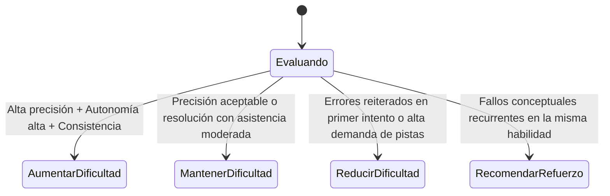

# ADAPTIVE_DIFFICULTY.md — Algoritmo de Dificultad Adaptativa

## 1. Principios del Algoritmo
El motor adaptativo de NEUROQUEST es **determinista**, **trazable** y **explicable**:
1. **Sin cajas negras opacas:** El jugador y el educador pueden auditar con exactitud por qué un reto sube, se mantiene o baja de dificultad.
2. **Sin dependencia de puntos acumulados:** El progreso no se basa en "farmeo" o acumulación de créditos virtuales.
3. **Mismo motor, calibración por competencia:** El algoritmo central es transversal, pero utiliza los parámetros pedagógicos específicos de cada ruta.

---

## 2. Variables de Entrada

Para cada desafío resuelto o intentado, el algoritmo procesa la tupla:
$$V = (P, I, H, T, D_c, R_{hist})$$

- $P$ (Precisión): Resultado binario de acierto (1 o 0).
- $I$ (Intentos): Número de intentos requeridos hasta la resolución (1..$N$).
- $H$ (Pistas utilizadas): Pistas solicitadas antes de enviar respuesta (0, 1, 2, ...).
- $T$ (Tiempo de reflexión): Tiempo transcurrido ponderado contra el promedio esperado para ese desafío.
- $D_c$ (Dificultad del desafío actual): Nivel de complejidad del reto (Nivel 1: Básico a Nivel 5: Avanzado).
- $R_{hist}$ (Historial reciente): Desempeño en los últimos $k$ desafíos de la misma habilidad ($k = 3..5$).

---

## 3. Estados de Ajuste del Sistema

El motor determina una de cuatro acciones posibles:

### Reglas Deterministas:

1. **Aumentar Dificultad ($D_{c} + 1$):**
   - Requiere 2 aciertos consecutivos en primer intento ($I = 1$).
   - Sin uso de pistas en ambos ($H = 0$).
   - Nivel actual menor al techo de la competencia ($D_c < 5$).

2. **Mantener Dificultad ($D_c$):**
   - Acierto logrado en el segundo intento ($I = 2$) o con una sola pista ($H \le 1$).
   - Demuestra comprensión básica pero requiere consolidar fluidez.

3. **Reducir Dificultad ($D_{c} - 1$):**
   - 2 fallos consecutivos o más de 3 intentos fallidos sin resolución.
   - Demanda de todas las pistas disponibles sin alcanzar la respuesta correcta.
   - Nivel actual mayor a 1 ($D_c > 1$).

4. **Recomendar Refuerzo Contextual:**
   - Si la dificultad ya está en Nivel 1 y persisten los fallos, el sistema activa una intervención pedagógica con explicación guiada (desglosando el concepto en subhabilidades previas) y genera una solicitud de asistencia al tutor inteligente (Gemini).
