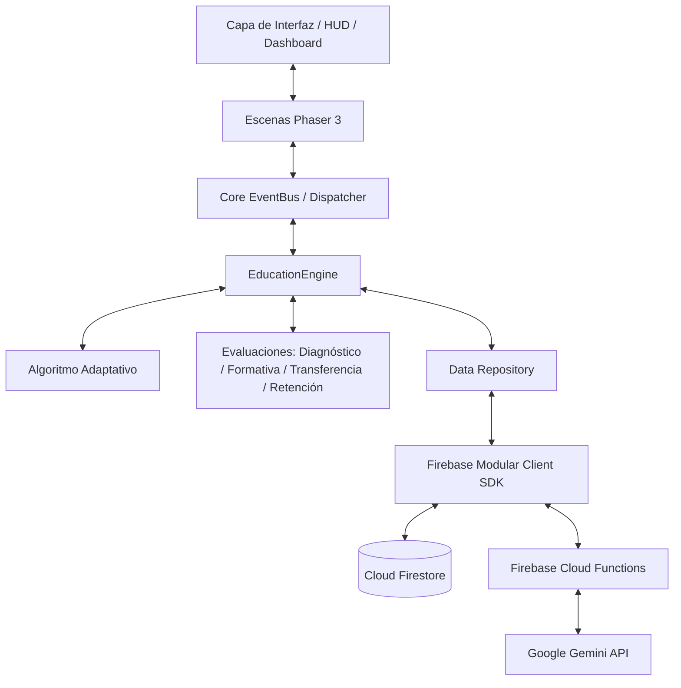

# ARCHITECTURE.md — Arquitectura del Sistema NEUROQUEST

## 1. Visión General y Principio de Desacoplamiento

NEUROQUEST implementa una arquitectura modular estratificada donde el bucle de renderizado y físicas del videojuego (**Phaser 3**) está estrictamente desacoplado del **Motor Educativo (`EducationEngine`)**, la **Capa de Persistencia (Firebase)** y el **Servicio de Tutoría IA (Gemini API)**.



---

## 2. Estructura de Directorios

```text
src/
├── config/                  # Configuraciones globales (Phaser, constantes de resolución)
├── core/                    # Bus de eventos global, gestión de estados de sesión
├── game/                    # Bucle y entidades de Phaser 3
│   ├── scenes/              # Escenas de Phaser (Boot, Preload, Welcome, SelectRoute, WorldScene, etc.)
│   ├── entities/            # Jugador, PNJs, entidades interactivas
│   ├── physics/             # Colisiones, zonas de activación y límites
│   └── objects/             # Terminales de desafío, puertas de validación, cofres de pistas
├── education/               # Dominio curricular y pedagógico (independiente de Phaser)
│   ├── engines/             # EducationEngine orquestador
│   ├── competencies/        # Definiciones curriculares (Rutas 01 a 04)
│   ├── assessments/         # Evaluaciones diagnósticas, formativas y sumativas
│   ├── adaptive/            # Algoritmo determinista de dificultad
│   ├── metrics/             # Cálculo de autonomía, consistencia, dominio y retención
│   └── repositories/        # Abstracción de acceso a datos de desafíos y progreso
├── services/                # Conexiones con servicios externos
│   ├── firebase/            # Firebase Auth, Firestore y llamada a Cloud Functions
│   └── gemini/              # Cliente seguro hacia Cloud Functions para tutoría IA
├── ui/                      # Elementos visuales superpuestos (HUD, Dashboard, menús DOM)
│   ├── menus/               # Selector de competencias, menús de pausa
│   ├── components/          # Tarjetas de desafío, modales pedagógicos
│   ├── hud/                 # Indicador de competencia activa, minimapa, brújula
│   └── dashboard/           # Panel analítico de aprendizaje individual
├── utils/                   # Funciones utilitarias puras (matemáticas, formateadores)
├── styles/                  # Hojas de estilo CSS optimizadas para pixel art
└── main.js                  # Inicialización y arranque de la aplicación
```

---

## 3. Capas Principales

### A. Capa de Videojuego (`src/game/`)
- Gestiona la entrada del jugador (teclado/ratón), el renderizado de tilesets pixel art, animaciones y detección de colisiones de proximidad.
- No almacena estado educativo ni evalúa directamente respuestas matemáticas o computacionales.
- Al interactuar con un objeto pedagógico (ej. una consola interactiva), notifica a través del bus de eventos.

### B. Capa de Educación (`src/education/`)
- Mantiene las especificaciones completas de las cuatro competencias.
- Contiene el `EducationEngine` que suministra desafíos según la competencia activa y el nivel de dificultad calculado.
- Registra el historial de intentos, tiempos y solicitudes de pistas para alimentar el motor adaptativo.

### C. Capa de Persistencia y Backend (`src/services/` & `functions/`)
- Persistencia asíncrona de los perfiles de usuario y su matriz de competencias individuales en Firestore.
- Google Cloud Functions para tareas sensibles: cálculo de certificaciones oficiales y orquestación con la API de Google Gemini.
