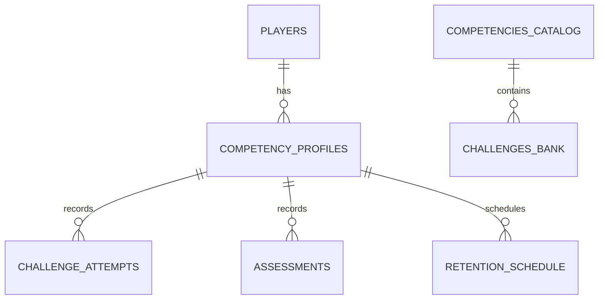

# DATABASE_DESIGN.md — Modelo de Datos en Cloud Firestore

## 1. Principio Estructural
La estructura de Cloud Firestore está diseñada para soportar **progreso independiente por competencia** para cada jugador. Los resultados, diagnósticos y evaluaciones de una ruta nunca se mezclan ni colisionan con las demás.

---

## 2. Esquema de Colecciones

### Colección: `players/{playerId}`
- `uid`: string (ID de Firebase Auth)
- `displayName`: string
- `email`: string
- `createdAt`: timestamp
- `lastActiveRoute`: string ("logic_math" | "computational_thinking" | "reading_comprehension" | "multidisciplinary")
- `activeRoutes`: array de strings

### Subcolección: `players/{playerId}/competencies/{competencyId}`
- `competencyId`: string (ej. "logic_math")
- `enrolledAt`: timestamp
- `currentDifficultyLevel`: number (1 a 5)
- `diagnosticCompleted`: boolean
- `diagnosticScore`: map { baselineLevel: number, accuracy: number, completedAt: timestamp }
- `metrics`:
  - `accuracy`: number (0 a 1)
  - `autonomyIndex`: number (0 a 1)
  - `consistencyIndex`: number (0 a 1)
  - `transferIndex`: number (0 a 1)
  - `retentionIndex`: number (0 a 1)
  - `totalChallengesSolved`: number
  - `totalAttempts`: number
  - `totalHintsUsed`: number
  - `timeSpentSeconds`: number

### Subcolección: `players/{playerId}/competencies/{competencyId}/attempts/{attemptId}`
- `challengeId`: string
- `skillId`: string
- `difficultyLevel`: number
- `isCorrect`: boolean
- `attemptsCount`: number
- `hintsRequested`: number
- `timeSpentSeconds`: number
- `timestamp`: timestamp
- `isTransfer`: boolean

### Subcolección: `players/{playerId}/competencies/{competencyId}/assessments/{assessmentId}`
- `type`: "diagnostic" | "formative_milestone" | "transfer_test" | "retention_check"
- `score`: number
- `masteryStatus`: "emergent" | "developing" | "proficient" | "mastered"
- `completedAt`: timestamp
- `officialValidation`: boolean (validado por backend/Cloud Function)

### Colección Global: `challenges/{challengeId}`
- `id`: string
- `competencyId`: string
- `skillId`: string
- `educationalObjective`: string
- `statement`: string
- `difficultyLevel`: number (1 a 5)
- `interactionType`: "multiple_choice" | "code_sequence" | "numerical_input" | "text_ordering"
- `expectedAnswerHash`: string (validación en backend)
- `explanation`: string
- `hints`: array de strings
- `rubricCriteria`: array de criterios
