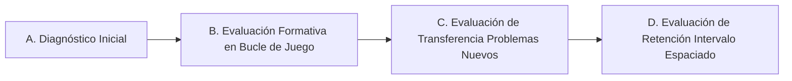

# EDUCATIONAL_MODEL.md — Modelo Pedagógico y de Evaluación

## 1. Fundamentos Pedagógicos

NEUROQUEST se aleja del modelo de "gamificación cosmética" (otorgar medallas o puntos por mera persistencia o repetición mecánica). El modelo pedagógico se cimenta en la **demostración de dominio**, la **evaluación formativa continua**, la **transferencia de habilidades a problemas inéditos** y la **retención espaciada**.

---

## 2. Tipos de Evaluación

### A. Evaluación Diagnóstica
- **Momento:** Al seleccionar una competencia por primera vez.
- **Objetivo:** Establecer la línea base cognitiva del estudiante en los contenidos de la ruta sin penalizaciones ni sesgo de frustración.
- **Efecto:** Posiciona la dificultad inicial recomendada del `EducationEngine`.

### B. Evaluación Formativa (In-Game)
- **Momento:** Integrada orgánicamente en terminales, puzles y desafíos del mundo.
- **Objetivo:** Monitorear el proceso de resolución, errores frecuentes y demanda de pistas en tiempo real.
- **Efecto:** Calibra de forma continua y transparente el nivel de desafío y activa retroalimentación pedagógica contextual.

### C. Evaluación de Transferencia
- **Momento:** Tras completar secuencias de aprendizaje de una habilidad.
- **Objetivo:** Comprobar si el estudiante puede aplicar el conocimiento a situaciones con estructura o contexto totalmente nuevos.
- **Regla Fundamental:** No utiliza variantes superficiales de problemas ya vistos; exige generalización del principio.

### D. Evaluación de Retención
- **Momento:** Presentada tras intervalos temporales calculados (efecto de práctica espaciada).
- **Objetivo:** Medir la consolidación en memoria a largo plazo y distinguir entre comprensión efímera y retención sólida.

---

## 3. Indicadores de Aprendizaje vs. Participación

Para evitar métricas infladas, el sistema segrega estrictamente dos dimensiones:

| Dimensión | Indicador | Definición |
| :--- | :--- | :--- |
| **Participación** | Tiempo en plataforma | Horas y minutos dedicados en la sesión. |
| **Participación** | Desafíos intentados | Cantidad total de interacciones iniciadas. |
| **Aprendizaje** | **Precisión Ponderada** | Ratio de aciertos considerando la dificultad intrínseca del reto. |
| **Aprendizaje** | **Índice de Autonomía** | Porcentaje de resolución exitosa sin requerir pistas ni ayudas auxiliares. |
| **Aprendizaje** | **Consistencia** | Mantenimiento de desempeño en series de problemas equivalentes. |
| **Aprendizaje** | **Índice de Transferencia** | Desempeño específico en retos estructuralmente nuevos. |
| **Aprendizaje** | **Retención Espaciada** | Éxito en desafíos reactivados transcurrido un lapso de tiempo. |

> [!IMPORTANT]
> El sistema **nunca promedia ni suma porcentajes de distintas competencias** en un único índice genérico de dominio. Cada ruta mantiene su independencia analítica.
