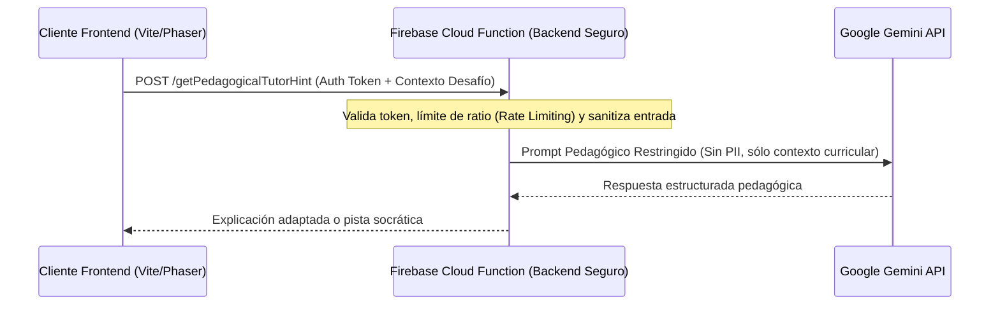

# SECURITY.md — Políticas de Seguridad y Protección de Datos

## 1. Principios de Seguridad
1. **Frontend Zero-Trust:** El cliente web no posee autoridad para certificar estados de dominio ni emitir dictámenes oficiales de evaluación.
2. **Cero Secretos en Cliente:** Las API Keys con privilegios administrativos y la clave de Google Gemini API **nunca** se empaquetan en el frontend ni se almacenan en variables accesibles en el navegador.
3. **Persistencia Segura en Firebase:** Reglas de seguridad estrictas en Cloud Firestore para aislar los datos entre usuarios.

---

## 2. Reglas de Seguridad en Cloud Firestore

- Un jugador sólo puede leer y escribir su propio perfil y sus propios intentos en curso:
  - `request.auth.uid == playerId`
- Las evaluaciones oficiales y estados de maestría (`masteryStatus`, `officialValidation`) sólo pueden ser escritos por Cloud Functions (`serviceAccount` o contexto admin).

---

## 3. Integración Segura con Gemini API

### Controles Estrictos para Gemini:
- **Rate Limiting:** Máximo 5 consultas por minuto por estudiante para evitar abusos y costos imprevistos.
- **Sin datos personales (PII):** Los prompts a Gemini sólo contienen el identificador curricular, el objetivo pedagógico y el error conceptual detectado; nunca nombres ni correos.
- **Modo Degradado / Fallback Local:** Si la cuota de la API se satura o el servicio no responde, el sistema entrega pistas locales predeterminadas del banco de desafíos sin interrumpir la experiencia de juego.
- **Sin autoridad evaluativa:** Gemini actúa como tutor y explicador pedagógico; no puede calificar exámenes oficiales ni alterar puntuaciones oficiales de la base de datos.
